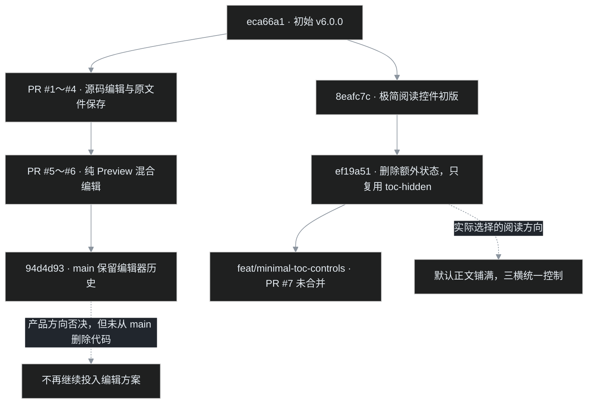
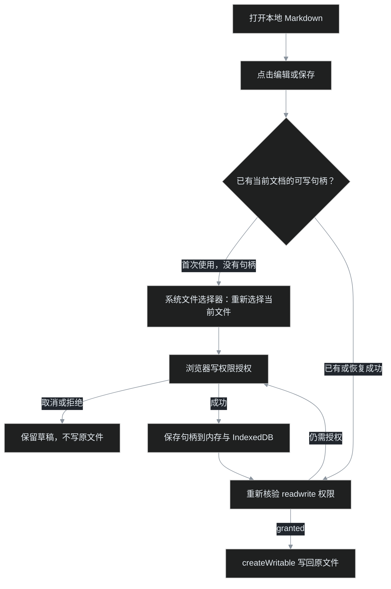
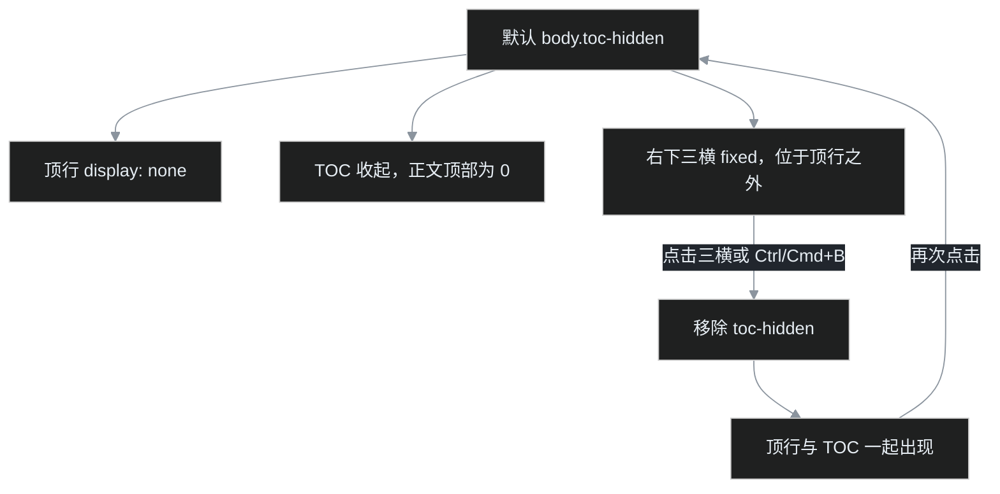

# 二次开发日志：Preview/Edit 与极简 TOC

> 记录范围：`yeyangchen2009/markdown-viewer-extension` 自用 fork，2026-11-12 至 2026-11-15。上游为 `markdown-viewer/markdown-viewer-extension`。本文只记录本仓库，不与 `simov/markdown-viewer` 的另一个 fork 混写。

## 一、版本结论与分支关系

两次尝试解决的是不同问题。第一版参照 VS Code，把阅读器扩展为可编辑、可写回本地文件的 Preview/Edit 工具；第二版不再增加编辑能力，只把顶行与目录收进右下角三横按钮。

| 版本 | 基线与终点 | 主要结果 | 记录时状态 |
|---|---|---|---|
| 初始上游版 | `eca66a1`，标签 `v6.0.0` | 完整的 Markdown 阅读、渲染、主题与导出能力 | 两条二次开发线的共同基线 |
| Preview/Edit 版 | `eca66a1` → `94d4d93` | 源码编辑演进为单栏 Preview 混合编辑，支持保存与原文件写回 | PR #1～#6 已合并进 main；代码仍保留，但产品方向已否决 |
| 极简 TOC 版 | 重新从 `eca66a1` 切出 → `ef19a51` | 默认隐藏顶行和 TOC，只保留右下三横，点击后两者一起显隐 | `feat/minimal-toc-controls`，个人 fork PR #7 未合并 |



这里有一个容易误读的拓扑：**极简分支不包含 Preview/Edit 的提交**，但 PR #7 的 base 是编辑器 main。若直接合并 PR #7，只会把极简阅读改动叠加到 main，不会自动删除 main 已有的编辑器代码。若要让 main 也回到纯初始阅读器，需要另行明确处理，不能把“合并极简 PR”等同于“回滚编辑功能”。

## 二、初始上游项目的目录与文件功能

以下只展开与本次二次开发有关的层级，不穷举所有语言包、渲染器和测试夹具。初始树以 `eca66a1` 为准；其中 `docs/` 与 `skills/` 是 gitlink，本提交不展开其内部文件。

```text
markdown-viewer-extension/
├── manifest.json                 # 跨平台扩展清单与能力声明的基础配置
├── package.json                  # 构建、测试脚本与 TypeScript 依赖
├── settings-schema.json          # 阅读器设置项及默认值约束
├── formats.json                  # 可识别文档格式配置
├── chrome/
│   └── src/
│       ├── main.ts               # Chrome 扩展入口
│       ├── host/                 # 后台、注入与宿主环境适配
│       ├── popup/                # 浏览器工具栏弹窗
│       ├── transports/           # 不同宿主之间的消息传输
│       ├── workspace/            # 文件工作区与 File System Access 工作区能力
│       └── webview/
│           ├── viewer-main.ts    # 独立阅读页主控制器，连接渲染、工具栏、TOC 与保存
│           ├── render-worker.ts  # 渲染工作任务
│           ├── runtime-bridge.ts # 页面与扩展运行时的桥接
│           └── ui/
│               ├── toolbar.ts    # 顶行工具栏、阅读按钮及其事件
│               ├── toc-manager.ts# TOC 生成、显隐与状态同步
│               ├── heading-anchors.ts
│               │                 # 标题锚点处理
│               └── progress-indicator.ts
│                                 # 阅读进度显示
├── src/
│   ├── core/                     # 与平台无关的文档、会话和阅读状态
│   │   ├── markdown-processor.ts # Markdown 处理主流程
│   │   ├── markdown-document.ts  # 文档模型
│   │   └── viewer/               # 阅读会话契约、状态与效果编排
│   ├── exporters/                # DOCX、PDF、HTML 等导出实现
│   ├── integration/              # 自定义元素与嵌入阅读器集成
│   ├── messaging/                # 内部消息协议
│   ├── plugins/                  # Markdown 与 HTML 处理插件
│   ├── renderers/                # Mermaid、PlantUML、Vega 等图形渲染器
│   ├── services/                 # 文档处理支撑服务
│   ├── themes/                   # 主题注册与主题资源
│   ├── types/                    # 公共 TypeScript 类型
│   ├── ui/
│   │   └── styles.css            # 阅读页、顶行、TOC 与响应式布局样式
│   └── utils/                    # 通用工具
├── edge/                         # Edge 平台入口与适配
├── firefox/                      # Firefox 平台入口与适配
├── vscode/                       # VS Code 宿主集成
├── obsidian/                     # Obsidian 宿主集成
├── mobile/                       # 移动端工程
├── slidev-shell/                 # Slidev 文档外壳
├── scripts/                      # 构建、打包与开发脚本
└── test/
    ├── fixtures/                 # Markdown 与布局测试材料
    ├── helpers/                  # 测试启动器和浏览器辅助函数
    └── suites/                   # 核心、导出、扩展 E2E、VS Code E2E 等测试
```

原项目已经把“文档处理”“阅读会话”“浏览器宿主”“具体平台”分层。二次开发应优先接入这些既有边界，而不是另建一套平行的阅读器状态。

## 三、版本一：参照 VS Code 增加 Preview/Edit

### 3.1 演进过程

| 时间 | 合并提交 / PR | 主要改动 |
|---|---|---|
| 2026-11-12 | `15c2251` / #1 | 增加源码编辑面板、实时预览、dirty 状态、Ctrl/Cmd+S、外部变更保护；本地保存通过文件句柄写回 |
| 2026-11-12 | `58f23b7` / #2 | 文件写入移到页面 MAIN world；isolated world 只传文本与结果，不跨 world 传活文件句柄 |
| 2026-11-12 | `fc4e93f` / #3 | 在编辑器的捕获阶段接管 Ctrl/Cmd+S，避免落入浏览器“网页另存为”；补充保存架构文档 |
| 2026-11-12 | `f10dbb6` / #4 | 文件句柄按文档保存在 MAIN world 内存 Map 与 IndexedDB，重载后恢复并重新核验权限 |
| 2026-11-13 | `70522dc` / #5 | 引入 VS Code Markdown 编辑器组件，形成非活动块渲染、活动块编辑源码的混合 Preview |
| 2026-11-13 | `94d4d93` / #6 | 删除编辑器内部的 Source textarea 与双栏切换，只保留单栏 Preview；补阅读位置、布局宽度和主题连续性 |

最终的编辑模型不是把渲染后的 HTML 任意转回 Markdown，而是让 `EditorModel.sourceText` 始终持有完整源文。独立工具栏的只读 Source Mode 与可编辑 Preview 是两项不同功能，前者保留，后者后来成为被否决的产品方案。

### 3.2 主要改动代码处

下列行号固定在编辑器终点 `94d4d93`，后续分支增删代码不会改变这些历史链接。

| 代码位置 | 职责与关键改动 |
|---|---|
| [`chrome/src/webview/ui/hybrid-editor.ts:63`](https://github.com/yeyangchen2009/markdown-viewer-extension/blob/94d4d93/chrome/src/webview/ui/hybrid-editor.ts#L63) | `createHybridEditor()` 创建 `EditorModel`、`EditorView`、`EditorController`；`sourceText` 是权威源文 |
| [`chrome/src/webview/ui/hybrid-editor.ts:213`](https://github.com/yeyangchen2009/markdown-viewer-extension/blob/94d4d93/chrome/src/webview/ui/hybrid-editor.ts#L213-L266) | `revealSourceLine()` 与 `captureCurrentLine()` 在阅读行号、字符 offset、Selection 之间转换，维持进出编辑的位置 |
| [`chrome/src/webview/ui/source-editor.ts:32`](https://github.com/yeyangchen2009/markdown-viewer-extension/blob/94d4d93/chrome/src/webview/ui/source-editor.ts#L32-L103) | 编辑器面板、保存状态、外部冲突条；在捕获阶段处理 Ctrl/Cmd+S，启停混合编辑器 |
| [`chrome/src/webview/viewer-main.ts:856`](https://github.com/yeyangchen2009/markdown-viewer-extension/blob/94d4d93/chrome/src/webview/viewer-main.ts#L856-L867) | dirty、saving、预览队列、权威内容 revision 等编辑状态接入阅读页主控制器 |
| [`chrome/src/webview/viewer-main.ts:1630`](https://github.com/yeyangchen2009/markdown-viewer-extension/blob/94d4d93/chrome/src/webview/viewer-main.ts#L1630-L1860) | 进入/退出编辑、更新预览、保存、冲突处理与文档重置的主流程 |
| [`chrome/src/webview/ui/toolbar.ts:608`](https://github.com/yeyangchen2009/markdown-viewer-extension/blob/94d4d93/chrome/src/webview/ui/toolbar.ts#L608-L620) | 顶行连接编辑与保存按钮事件 |
| [`chrome/src/webview/ui/toolbar.ts:1100`](https://github.com/yeyangchen2009/markdown-viewer-extension/blob/94d4d93/chrome/src/webview/ui/toolbar.ts#L1100-L1110) | `toggle-edit-btn` 与 `save-source-btn` 的按钮结构 |
| [`chrome/src/webview/source-file-writer-main.ts:41`](https://github.com/yeyangchen2009/markdown-viewer-extension/blob/94d4d93/chrome/src/webview/source-file-writer-main.ts#L41-L98) | IndexedDB 恢复与持久化、MAIN world 私有句柄 Map、首次 `showOpenFilePicker()` |
| [`chrome/src/webview/ui/source-file-writer.ts:51`](https://github.com/yeyangchen2009/markdown-viewer-extension/blob/94d4d93/chrome/src/webview/ui/source-file-writer.ts#L51-L64) | 查询/请求 `readwrite` 权限，`createWritable()` 写入；失败时中止写入，保留未保存状态 |
| [`src/ui/styles.css`](https://github.com/yeyangchen2009/markdown-viewer-extension/blob/94d4d93/src/ui/styles.css) 与 [`src/utils/theme-to-css.ts`](https://github.com/yeyangchen2009/markdown-viewer-extension/blob/94d4d93/src/utils/theme-to-css.ts) | 编辑页面、活动块、代码、iframe 表面和光标复用阅读主题变量，切换主题不重建编辑器 |
| [`chrome/docs/markdown-source-save.md`](https://github.com/yeyangchen2009/markdown-viewer-extension/blob/94d4d93/chrome/docs/markdown-source-save.md) | 保存能力边界、MAIN world 架构、阅读连续性与真实 Edge 验收约束 |

编辑器专项测试位于 `test/suites/extension-e2e/` 的 `hybrid-editor.test.ts`、`hybrid-navigation.test.ts`、`hybrid-theme.test.ts` 和 `source-editor.test.ts`，分别覆盖混合编辑、阅读位置与布局、主题切换、保存及句柄恢复。

### 3.3 首次授权流程与产品否决

浏览器“允许访问文件 URL”只解决扩展读取和注入权限，**不等于允许扩展覆盖任意本地文件**。从 `file://` URL 不能静默取得可写句柄。首次写回必须由用户明确选择当前文件并授权，后续才可以复用内存或 IndexedDB 中的句柄。



技术上演进已经减少了后续保存的打断，但不能消除第一次选路径与授权。对实际使用而言，为了少量阅读中的修改，每次首次接触一个文件都要重新定位路径，操作成本高于收益，因此否决继续维护 Preview/Edit 的方向，回到轻量阅读与极简目录入口。

测试证据也必须与这个决策分开理解：编辑版曾在同一份构建上完成本机 Edge 安装版专项回归 18/18，但原生 picker 自动化使用 mock，OPFS 只验证可序列化句柄的恢复，**不等于真实系统授权和真实磁盘覆盖已自动验收**。方案被否决是使用成本判断，不应倒写成“所有编辑测试都失败”。

## 四、版本二：极简 TOC 三横按钮

### 4.1 最终交互

最终只保留一条交互：默认正文铺满，顶行与 TOC 都隐藏；页面只常驻右下角三横。点击三横，顶行与 TOC 一起出现；再点一次，两者一起收起。顶行原有内容不变，不围绕下载、主题或其他阅读设置另做新功能。



实现只复用原项目的 `toc-hidden`，没有第二套阅读控制状态。三横必须是 `#page-header` 外部的兄弟节点，否则顶行 `display:none` 会把按钮一起隐藏。

### 4.2 两次提交与范围收敛

| 提交 | 改动 |
|---|---|
| `8eafc7c` | 从初始 `v6.0.0` 实现默认收起、右下三横与顶行/TOC 联动；初版额外增加了阅读控制状态与较多专项资产 |
| `ef19a51` | 按“只要简单交互”的要求重改：删除 `src/ui/reader-controls.ts`、无标题专项 fixture 和多余断言，统一读取 `body.toc-hidden`；本提交净删 87 行 |

被删除的 `reader-controls.ts` 和 `test/fixtures/layout/no-headings.md` 属于被否决的过度实现，**当前极简分支不存在这两个文件**。

### 4.3 主要改动代码处

下列链接固定在极简终点 `ef19a51`。

| 代码位置 | 最终改动 |
|---|---|
| [`src/core/viewer/viewer-session-contract.ts:11`](https://github.com/yeyangchen2009/markdown-viewer-extension/blob/ef19a51/src/core/viewer/viewer-session-contract.ts#L11-L20) | `resolveDefaultTocVisibility()` 对 browser、panel、embedded 默认返回 `false` |
| [`chrome/src/webview/ui/toolbar.ts:447`](https://github.com/yeyangchen2009/markdown-viewer-extension/blob/ef19a51/chrome/src/webview/ui/toolbar.ts#L447-L491) | `setTocVisibility()` 同步 `body.toc-hidden`；三横和 Ctrl/Cmd+B 根据同一 body 状态切换 |
| [`chrome/src/webview/ui/toolbar.ts:1103`](https://github.com/yeyangchen2009/markdown-viewer-extension/blob/ef19a51/chrome/src/webview/ui/toolbar.ts#L1103-L1114) | 三横 SVG 按钮移到 `#page-shell` 内、`#table-of-contents` 前，不再藏在顶行内部 |
| [`chrome/src/webview/viewer-main.ts:848`](https://github.com/yeyangchen2009/markdown-viewer-extension/blob/ef19a51/chrome/src/webview/viewer-main.ts#L848-L879) | 预测布局与实际状态都通过 `toc-hidden` 同步；不再用另一套控件状态覆盖 TOC |
| [`chrome/src/webview/viewer-main.ts:1173`](https://github.com/yeyangchen2009/markdown-viewer-extension/blob/ef19a51/chrome/src/webview/viewer-main.ts#L1173-L1174) | 初始化应用收起状态；左右 TOC 布局切换不再把三横移回顶行 |
| [`chrome/src/webview/ui/toc-manager.ts:196`](https://github.com/yeyangchen2009/markdown-viewer-extension/blob/ef19a51/chrome/src/webview/ui/toc-manager.ts#L196-L236) | 没有已保存状态时默认收起；Mithril/TOC 更新继续同步原 body class |
| [`src/ui/styles.css:199`](https://github.com/yeyangchen2009/markdown-viewer-extension/blob/ef19a51/src/ui/styles.css#L199-L201) | `body.toc-hidden #page-header { display: none; }`，顶行跟随原 TOC 状态 |
| [`src/ui/styles.css:312`](https://github.com/yeyangchen2009/markdown-viewer-extension/blob/ef19a51/src/ui/styles.css#L312-L330) | 三横固定右下 20px，弱化默认透明度；嵌入与打印场景不显示，移动端边距为 16px |
| [`test/suites/extension-e2e/minimal-reader-controls.test.ts:62`](https://github.com/yeyangchen2009/markdown-viewer-extension/blob/ef19a51/test/suites/extension-e2e/minimal-reader-controls.test.ts#L62-L88) | 一个核心用例验证默认收起、三横位置、同步展开、再次收起与页面异常 |
| [`test/suites/extension-e2e/save-file-name.test.ts`](https://github.com/yeyangchen2009/markdown-viewer-extension/blob/ef19a51/test/suites/extension-e2e/save-file-name.test.ts) | 原下载测试先点击三横、等待顶行可见，再执行原流程；只是适配新默认布局，不是新增下载功能 |

### 4.4 实际验证与边界

| 验证项 | 结果 |
|---|---|
| 默认 TOC 状态单元测试 | 5/5 通过 |
| 真实 headed Edge 核心交互 | 1/1 通过，覆盖收起 → 展开 → 再收起 |
| 截图目检 | closed 只有正文与右下三横；open 同时出现顶行和左侧 TOC |
| 完整扩展测试套件 | 本轮未重跑，不能记作全绿 |
| 全量 TypeScript 检查 | 未宣称通过；项目仍有既有依赖与 DOCX 错误，Windows 包装脚本也存在退出码问题 |

## 五、保留下来的工程结论

1. **能力可实现，不等于产品值得保留。** 本地写回必须服从浏览器授权边界；首次选文件的摩擦无法靠持久化句柄彻底消除。
2. **极简交互只需要一个事实源。** 顶行与 TOC 共用 `toc-hidden`，比新增 `reader-controls` 状态更容易维护，也避免快捷键与按钮状态分裂。
3. **隐藏容器前先看按钮的 DOM 位置。** 常驻入口必须位于被隐藏的顶行之外，否则样式会让用户失去重新展开的途径。
4. **文档记录版本，不把历史包装成当前功能。** main 的编辑器代码、极简分支的当前实现、PR 的合并状态是三个不同事实，后续维护应分别核对。
