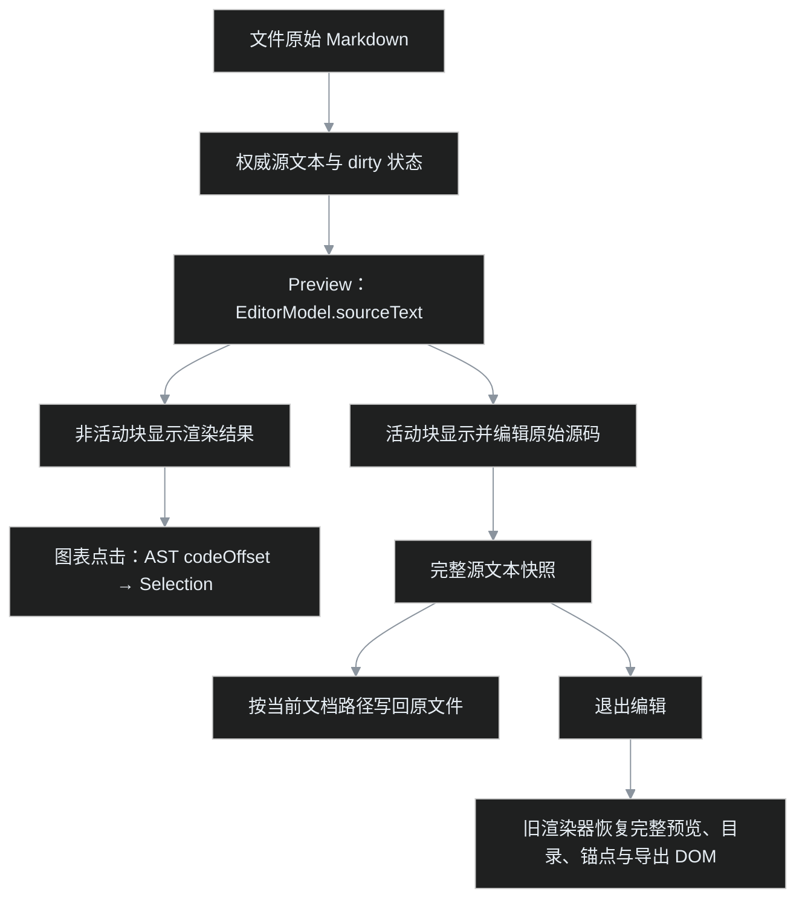
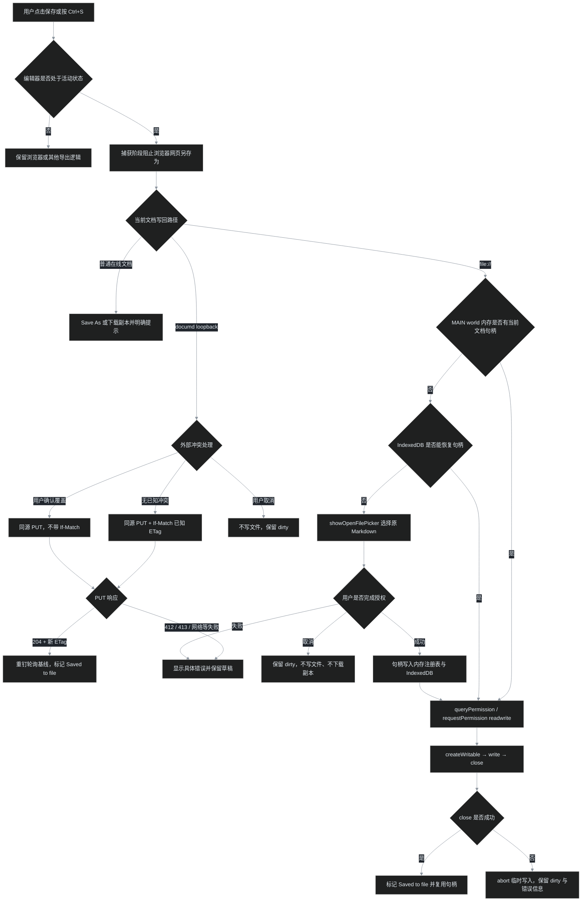
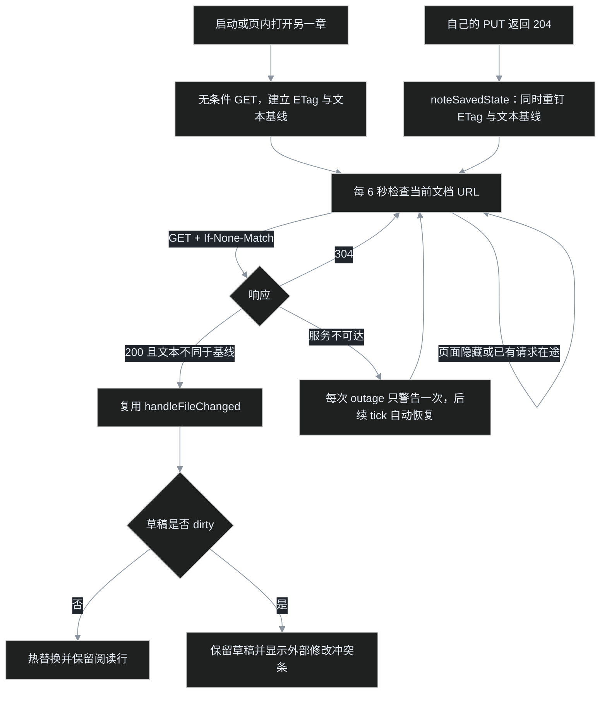

# 浏览器编辑 Markdown 与原文件保存

> 调研与实现约束，2026-11-13；`documd serve` 写回与外部修改感知补充于 2026-11-24。适用于本 fork 的 Chrome / Edge 混合编辑器与源码编辑器；Firefox、移动端和普通在线文档不承诺相同能力。

## 结论

浏览器可以编辑 Markdown 并覆盖本地原文件，但不能仅凭 `file:///...` 地址静默写入。`file://` 的正确方式是：**用户交互 → 明确选择文件 → 取得文件句柄与写权限 → 写入并关闭流**。首次授权后，句柄同时保存在 MAIN world 内存注册表和 IndexedDB；后续 Ctrl+S 及页面重载都应复用或恢复句柄、重新核验写权限，而不是再次弹文件选择器，也不应退化为下载副本。

本 fork 另有第二条本地写回路径：用户先运行 `documd serve <目录>`，再通过带随机 token 的 loopback URL 打开 Markdown。扩展在 isolated world 内对当前文档发同源条件 GET 与 PUT；服务端用强 ETag 检测并发修改，以同目录临时文件加重命名提交写入。这条路径不使用文件句柄、不经过 MAIN world，也不依赖 service worker。

如果编辑态 Ctrl+S 仍出现浏览器“网页另存为”，说明快捷键没有进入编辑器保存逻辑；如果出现 `showSaveFilePicker()` 或下载，则说明走到了“保存副本”分支。这两种情况都不能记作原文件写回成功。

## 能力边界

| 场景 | 可实现的保存结果 | 必要条件或限制 |
|---|---|---|
| 普通网页直接按 Ctrl+S | 浏览器默认“网页另存为” | 页面须拦截快捷键并调用自己的保存逻辑 |
| `<input type="file">` 读取的 `File` | 下载编辑后的副本 | 普通 `File` 不提供原文件写回能力 |
| `showOpenFilePicker()` 取得的文件句柄 | 覆盖用户选中的原文件 | 安全上下文、transient user activation、文件句柄和写权限 |
| 只有 `file://` URL，没有文件句柄 | 不能据此直接覆盖磁盘文件 | “允许访问文件 URL”只解决扩展读取/注入权限，不是任意写文件权限 |
| `documd serve` 的 loopback Markdown | 同源 PUT 覆盖服务目录内的现有文件；条件 GET 感知外部修改 | 仅 Chrome／Edge isolated world；必须保留正确 token；正常保存以 `If-Match` 保护，失败不下载 |
| 普通在线 Markdown | 另存副本；站点另有 API 时才可提交远端 | 非 loopback HTTP 不进入本地 PUT 分支，扩展不应把远端文档当本地原文件写入 |
| 不支持 File System Access API 的浏览器 | 下载副本或交由原生助手保存 | 不伪装成原文件写回 |

`showOpenFilePicker()` 在 MDN 中仍标为 **Limited availability**，因此运行时必须做能力检测，不能只凭 Chromium 内核名称假定所有上下文均可用。

## 混合编辑架构

编辑入口只有单栏 **Preview**：非活动块显示渲染结果，点击块后直接编辑该块的 Markdown 源码。编辑器内不再提供 Source textarea 或双栏切换；保存状态、Ctrl/Cmd+S、dirty、外部修改冲突条和同一份权威源文本均直接连接混合编辑器。工具栏独立的只读 **Source Mode** 代码视图是另一项功能，继续保留。



实现复用 **`@vscode/markdown-editor@0.0.2-179`** 的 `EditorModel`、`EditorView`、`EditorController` 和 `LocalHistoryStrategy`。`EditorModel.sourceText` 保存精确 Markdown，不做任意 HTML → Markdown 往返；保存直接读取完整模型快照。权威外部内容通过 `replaceSourceText()` 载入，并抑制初始化及回显过程中的 `onInput`，防止空内容覆盖草稿。

### 渲染与源码边界

- **Preview 输入不重绘旧阅读 DOM。** 每次输入只更新源文本和 dirty。退出编辑时，按 `sourceEditorPreviewContent` 判断是否需要用最新源文本恢复完整阅读 DOM，并继续复用预览队列与位置恢复。
- **模型保存必须保留精确换行。** 权威文本不经过 textarea，Preview 编辑和保存读取同一份 `EditorModel.sourceText` 快照，设计目标是未修改的 CRLF、LF 和末尾换行不被 DOM 规范化改写。2026-11-24 的真实 Edge 验收却发现 CRLF 与末尾换行仍会在 loopback 保存时丢失，详见下方实测记录；独立修复前不得把这条设计约束写成已验收能力。
- **图表继续走原安全渲染服务。** Mermaid 等非活动 fence 复用 `platform.renderer.render()` 和 `createPluginResultElement()`。组件对自定义块缺少可靠命中映射，因此占位根节点的 `pointerdown` 通过 AST 累计偏移和 `CodeBlockAstNode.codeOffset` 设置 `Selection.collapsed()`；收集时排除已展开的活动图表，保证连续点击多个图表不会错位。渲染失败保留原始 fence 可编辑。
- **同源文本，不等于同渲染管线。** Preview 使用 VS Code 组件内建的 Markdown 块渲染；完整阅读态继续使用原 markdown-it、目录、锚点、图表和导出管线。Slidev、HTML 转 Markdown、workspace/嵌入模式不开放本地源码编辑入口。
- **运行要求是支持 `EditContext` 的现代 Chromium。** Preview 混合编辑要求 Chrome 121 或更新版本；构建目标中的 Chrome 120 保留阅读与独立只读 Source View，但隐藏混合编辑和保存入口，不退化为简单 `contenteditable`。

### 阅读位置与布局连续性

阅读和 Preview 是两个不同排版、不同滚动容器，不能互相复制像素 `scrollTop`。切换时沿用 VS Code 的源码导航通路：阅读块 `data-line` → 0-based source line → 精确 Markdown 字符 offset → `Selection` / `OffsetRange` → `revealRangeAtTop()`。换行扫描同时支持 CRLF、LF 和 CR；CRLF 的字符 offset 必须计入两个字符。

| 阅读布局 | Preview 内容宽度 | 同步方式 |
|---|---:|---|
| normal | 最大 `1360px` | 向 `limitedWidth` observable 写入数值 `1360` |
| fullscreen | 不限宽，随视口变化 | observable 的**值**设为 `undefined` |
| narrow | 最大 `680px` | 向 `limitedWidth` observable 写入数值 `680` |

进入编辑和工具栏布局切换都更新同一个 observable。不能省略 `limitedWidth`（组件默认会变成 `900px`），也不能用普通选项 `limitedWidth: undefined` 代替可写 observable；normal、fullscreen、narrow 不互相拉平。

编辑颜色与阅读主题共用动态 CSS 变量，主题切换不重建编辑器：

| 编辑区域 | 主题变量 |
|---|---|
| 页面、编辑 host、正文 | `--md-page-bg`、`--md-text-color` |
| 行内代码、代码块 | `--md-code-bg`，来自主题 `background.code` |
| 活动块背景及 8px 光晕 | `--md-block-active-background` → `--md-accent-bg` |
| iframe、代码复制等浮动表面 | `--md-iframe-background` → `--md-surface` |
| 自绘光标 | `--md-cursor-background` → `--md-text-color` |

不使用编辑器专用的暗色硬编码。只改变量而保留组件有意的透明层次；代码块使用实色主题表面，选中区仍保持可见的半透明强调色。

定位与退出遵循以下规则：

- 激活后在有界的 animation frame 窗口内重复 reveal，覆盖首次测量及图片、Mermaid 等异步高度变化；新定位、权威内容替换、停用以及 wheel、pointer、touch、key 输入都会取消旧任务，避免延迟校正抢回用户已经滚走的位置。
- 退出前从公开 `documentViewNode.blocks` 中捕获视口内首个正文块，排除 `emptyBlock`，再由 `absoluteStart` 转回 source line，并显式交给阅读预览的渲染与恢复管线。
- 阅读行号可能带有块内小数进度。若本次进入后没有真实滚动或编辑，退出直接保留进入时的精确行号，避免反复取整到块起点而累计漂移；实际编辑可能在其上方增删行，因此编辑后重新捕获，不能沿用旧行号。
- 连续切换、文档重置或新渲染会使旧的预览恢复任务失效。恢复只保证对应源码块和块内位置，不宣称两种渲染器具有相同像素几何。

## 保存架构



### 为什么 file:// 使用页面 MAIN world

扩展 isolated world 与页面 MAIN world 都能看见部分 Web API，不代表权限行为相同。WICG 的扩展相关 issue 记录了文件选择器、句柄权限提示的 Chromium 实现问题。因此本 fork 让页面 MAIN world 持有 `FileSystemFileHandle`，isolated world 只通过 DOM `CustomEvent` 传递文本请求与状态。

活文件句柄不跨 world 传递；句柄按去掉锚点后的文档 URL 隔离，避免页内打开另一份 Markdown 后误写旧文件。内存注册表保留在首次注入的闭包中，`ready` 标记防止重复注入时重置；IndexedDB 负责页面重载后的恢复。句柄不挂到 `window`，避免把写权限暴露给其他页面脚本。持久化失败不阻断本次保存，当前页仍走内存复用。

本机 Edge 实测确认 `file://` 页面可使用并在重载后保留 IndexedDB，但不能使用 OPFS（`navigator.storage.getDirectory()` 抛 `SecurityError`）。因此持久化自动化在扩展源页面取得真实、可序列化的 OPFS `FileSystemFileHandle`；本地文件页的 picker 仍使用 mock。这个架构是规避已知扩展上下文问题的实现选择，**不是对真实 Edge 原生对话框和磁盘写入的自动化测试替代品**。

### documd loopback 使用 isolated world

`file://` 的 MAIN world 句柄桥不适用于 HTTP 文档。loopback 分支只在 Chrome 平台、`chrome.runtime.id` 存在且 `isLoopbackHttpUrl()` 精确识别 `http://127.0.0.1`、`http://[::1]` 或 `http://localhost` 时启用；普通 HTTP／HTTPS 页面仍保存副本。同源 XHR 不需要新增 host 权限，也不受页面 worker CSP 影响。PUT 直接发送 `TextEncoder` 编码的 UTF-8 字节，失败向上抛出，绝不退化为下载。

服务端只绑定 `127.0.0.1`，并组合随机 token、Host 白名单、根目录约束和“只允许覆盖现有普通文件”限制。成功写入通过目标同目录临时文件加重命名提交。完整安全边界与状态码见 [CLI 的 serve 文档](../../scripts/cli-README.md#loopback-server-documd-serve)。**token URL 本身就是读写凭证**：不要公开分享，验收结束后停止服务。

外部修改轮询与 `file://` tracker 完全分离，不经过 `background.ts`、service worker 或 alarms：



正常保存使用 watcher 已知的当前 ETag 作为 `If-Match`；磁盘已变化时，服务端返回 412，编辑器保留 dirty 并显示真实错误。用户明确确认覆盖冲突时才省略本次 `If-Match`。PUT 成功后立即采用响应 ETag 和已保存文本，因此自己的回显通常成为下一次 304，连续保存也不会拿旧验证器制造假 412。

页内 Markdown 导航有意保持地址栏 URL 不变，不能只监听 `location.href`。viewer 显式记录当前 loopback 章节，在渲染前重启 watcher；后续轮询、相对资源解析和保存都指向屏幕上的当前文档，而不是最初打开的章节。

## 实现不变量

1. **原文件保存与副本保存必须可区分。** 本地 `file://` 使用 `showOpenFilePicker()`；`documd serve` 文档使用同源 PUT；普通在线文档才使用 `showSaveFilePicker()` 或下载。
2. **本地失败不静默下载。** 授权失败、API 不可用、PUT 返回错误或写入异常时保留 dirty，并显示真实错误；不得让“下载成功”掩盖原文件未写入。
3. **快捷键在编辑态优先处理。** 编辑器创建后立即绑定捕获阶段 Ctrl/Cmd+S，阻止 Edge 默认 Save Page 和后续工具栏监听器重复处理。
4. **保存以完整源码为真源。** 保留末尾换行，直接从模型快照保存，不从渲染 DOM 反推 Markdown。
5. **写回目标与当前文档一一对应。** `file://` 句柄按去掉锚点后的文档 URL 隔离；loopback 每次从当前章节 URL 推导 PUT 目标。中文路径、`#` 锚点和页内导航都不得导致误写旧文件。
6. **失败写入不能提交半份文件。** `file://` 在 `createWritable()` 后执行 `write()`，仅在成功时 `close()`，异常时 `abort()`；loopback 服务端先写目标同目录临时文件，成功后重命名，失败清理临时文件。
7. **保存期间继续输入仍保持未保存。** 只更新本次快照的保存基线，不能把较新的输入一并标为已保存。
8. **外部磁盘修改不得静默覆盖草稿。** 冲突由用户明确选择加载磁盘版本或保留草稿；loopback 正常保存另以 `If-Match` 把尚未被轮询发现的并发修改变成 412，而不是直接覆盖。
9. **写回状态必须能跨重载正确重建。** `file://` 优先读取 MAIN world 内存，再恢复 IndexedDB，最后才显示 picker，恢复后仍核验 `readwrite` 权限；loopback 不持久化文件句柄，页面重载后通过无条件 GET 重建 ETag 与文本基线。
10. **Preview 只有一份草稿。** 任务框、图表 fence 编辑、主题切换和撤销/重做都更新同一权威源文本，不重建或替换编辑器模型。
11. **混合输入不能销毁自身。** 旧阅读渲染器不得在 Preview 每次按键时替换编辑 DOM；退出编辑才恢复最新完整预览。
12. **loopback 写回只能经过 isolated world 的专用分支。** 必须同时通过 Chrome 平台、扩展运行时和精确 loopback URL 谓词放行；`file://` 的 MAIN world 句柄路径、其他浏览器表面与普通在线文档不得因此改变。

## 验收矩阵

| 层级 | 能验证什么 | 不能替代什么 |
|---|---|---|
| 保存模块与 watcher 的 Node 契约 | picker 分支、句柄复用、精确文本、异常 abort、本地失败不下载；立即基线、条件轮询、hidden／在途跳过、outage 恢复、保存后重钉基线 | 真实系统对话框、真实浏览器渲染与真实磁盘 |
| `documd serve` 服务端契约 | MIME、token／Host／根目录约束、ETag／304、If-Match／412、原子写、请求体上限和中文路径 | 扩展是否选对写回分支及用户交互 |
| 安装扩展 loopback E2E | 真实 Chromium＋生产 serve 工厂、真实键盘保存、正常／覆盖 PUT 请求头、磁盘字节、干净热替换保滚动、脏草稿冲突、回显抑制、页内导航切换 | 真实 Edge 人工视觉、中文 IME、人工断服与原生 file:// picker |
| 安装扩展混合编辑 E2E | 纯 Preview 真实键盘输入、undo/redo、任务框、双 Mermaid 点击、CRLF、冲突保护、退出恢复、default/midnight 实时主题颜色与对比度 | 中文 IME、所有图表类型与所有主题的人工视觉验收 |
| 安装扩展 file:// 保存 E2E（Playwright Chromium / 本机 Edge） | 中文路径＋编码锚点、真实 Ctrl+S 事件、MAIN world 桥、dirty、保存期间继续输入、真实 OPFS 句柄在重复注入与重载后恢复 | 本地文件原生授权 UI 与真实磁盘覆盖 |
| 真实 Edge 人工验收 | 原生“打开”授权、连续保存与重载后免选择器、loopback 渲染／写回／冲突／导航／断服恢复、磁盘文件确实更新、Edge 默认另存为被拦截 | — |
| Edge ZIP 完整性检查 | 构建入口、文件清单、压缩包 CRC | 编辑器行为正确性 |

真实 Edge 验收使用临时 Markdown 副本，不使用用户原始调研文件做写入测试。loopback 验收前加载最新 `dist/chrome`，并让服务只指向 `F:\temp` 下的临时副本目录：

```bash
documd serve <F:\temp 下的临时副本目录> --port 4317
```

### 2026-11-24 真实 Edge 辅助实测记录

本轮在真实 Edge 157 中加载最新 `dist/chrome`，使用 Browser Skill 操作独立 Agent 标签页，CDP 只用于等待 DOM、编排磁盘竞态和只读核对。服务根目录只有临时 Markdown 副本。下列结果是辅助实测证据，**不等于用户本人已经完成人工验收**，因此下方复选框保持未勾选。

| 已实测行为 | 结果 |
|---|---|
| 主文档正常保存及自存回显 | Ctrl+S 无 picker、无下载，磁盘与预期文本逐字相等；跨 watcher 周期无冲突 |
| 干净阅读态外部修改 | 新文本热替换，保持 dirty=false；`scrollTop` 漂移 9.333px，对应标题的文档位置基本不变，在现有 E2E 的 100px 容差内 |
| 脏草稿冲突条 | 草稿未被覆盖；“保留我的草稿”和“加载磁盘版本”均实测，加载前的取消与确认路径均正确 |
| 真实 412 竞态 | watcher 刚收到 304 后从浏览器外部改盘并立即保存，得到 HTTP 412；dirty 保留，外部磁盘版本未被截断；确认覆盖后保存成功 |
| 保存期间继续输入 | 较早快照落盘，较新的输入仍在编辑器并保持 dirty，状态为 `Earlier draft saved; latest changes unsaved` |
| 断服与恢复 | 保存报真实网络错误且不下载、磁盘不变；同地址重启后 watcher 自动发现后续外部修改，确认覆盖可再次保存 |
| 页面重载 | 重载后重新建立 ETag 基线；再次编排外部改盘可得到真实 412，确认覆盖后保存成功 |
| 未保存离开保护 | dirty 页面导航触发真实 `beforeunload`；未处理对话框时导航被取消，仍停留原页 |

本轮同时发现三个**未通过项**，不能用其他成功项抵消：

| 未通过项 | 实测现象与当前边界 |
|---|---|
| 页内导航后的序列化 | 页内打开第二份文档后只修改首标题，保存却把相对链接改写成带 loopback token 的绝对 URL；保存目标虽是新文档，内容不满足逐字保真，需独立修复并清除临时文件中的凭证 |
| CRLF 与末尾换行 | CRLF 文档只修改首标题，保存后 7 个 CRLF 全部变成 LF，末尾 CRLF 也丢失；当前不能宣称混合编辑 loopback 保存保留原始换行 |
| 完整超限 PUT | 声明超限的 `Content-Length` 预检能返回 413 且不改文件；完整发送超限 body 时，Node 得到 `ECONRESET`，真实 Edge 得到 `TypeError: Failed to fetch`，而不是预期 413。原文件仍未修改，但响应契约需独立定位 |

中文 IME、原生 `file://` picker、完整视觉检查和用户本人执行的断服恢复仍须按清单人工完成；Browser Skill、Playwright 和 CDP 结果不得冒充这些证据。

### Loopback / documd serve

- [ ] 打开启动时打印的带 token URL，中文、表格、任务框、KaTeX、Mermaid PNG 均正常，开发者工具没有 pageerror。
- [ ] Preview 编辑后 Ctrl+S 不出现网页另存为、文件选择器或下载；状态为 `Saved to file`，dirty 清除，磁盘 UTF-8 字节逐字相等，另用 CRLF 文档确认换行与末尾换行未被规范化。
- [ ] 保存期间继续输入，落盘的是本次快照，较新的输入继续保持 dirty。
- [ ] 外部修改临时副本：干净阅读态热替换并保持阅读位置；脏草稿不被覆盖，冲突条的“加载磁盘版本”和“保留我的草稿”均符合选择。
- [ ] watcher 已建立旧 ETag 基线后，在外部修改后、下一次轮询前直接 Ctrl+S，出现 412 对应的真实错误，dirty 保留且磁盘不被截断；确认覆盖后再保存才更新磁盘。
- [ ] 自己保存后的轮询回显不弹冲突条；页内打开另一份 `.md` 后，外部修改轮询与 Ctrl+S 都指向新章节，地址栏保持原 URL 不影响目标判断。
- [ ] 停止服务后保存显示真实网络错误且不下载；重启同一服务后轮询自动恢复；重载页面能通过新的无条件 GET 建立基线。
- [ ] 安全抽检：无 token／错 token 为 404，伪造 Host 为 403，`..%2f` 穿越为 403，超过 `--max-body-mb` 的 PUT 为 413，失败请求均不修改原文件。
- [ ] 验收完毕停止 serve；不公开浏览器历史、终端输出或截图中的完整 token URL。

### 混合编辑与 file:// 回归

- [ ] 在长文档中部进入 Preview，对应标题或段落仍可见；未修改及修改后退出均回到对应阅读块，连续切换不累计漂移。
- [ ] normal、fullscreen、narrow 三档进入 Preview 后分别保持 `1360px`、不限宽、`680px`，编辑中切换布局也保持相同语义。
- [ ] CRLF 文档及目标上方延迟加载图片不会把定位挤到相邻段；主动滚动后不被旧校正拉回。
- [ ] Preview 中点击标题、段落和列表，真实输入、撤销/重做及中文 IME 正常；编辑器内没有 Source 切换或 textarea，独立只读 Source Mode 仍可用。
- [ ] default、midnight 等明暗主题进入编辑后保持原阅读页面/代码底色；活动块光晕、光标和文字清晰，编辑中切换主题不丢草稿。
- [ ] Mermaid、PlantUML 非活动块正常显示，点击后编辑对应原始 fence；至少连续点击两个图表确认映射。
- [ ] 切换明暗主题并检查窄屏布局；图表、正文、活动源码和状态栏保持可读。
- [ ] 退出编辑后恢复完整预览、目录、锚点与导出 DOM；未保存关闭或导航仍触发离开保护。
- [ ] 编辑临时副本后按 Ctrl+S，不出现浏览器“网页另存为”。
- [ ] 第一次本地保存只要求通过“打开”对话框选择当前文件；后续保存复用句柄。
- [ ] 保存后重载同一 Markdown，再按 Ctrl+S，只核验权限，不要求重新从文件夹选择文件。
- [ ] 保存后磁盘内容逐字等于编辑器内容，状态为 `Saved to file`，dirty 清除。
- [ ] 取消选择器后仍显示未保存，不产生下载副本。
- [ ] 拒绝权限或写入失败时显示具体错误，原文件不被截断。
- [ ] 保存期间继续输入，较早快照保存后，较新内容仍保持 dirty。
- [ ] 在线 Markdown 明确显示“保存副本”，不冒充本地写回。

## 证据与来源

以下来源在本轮通过 `gh` / `curl` 实际读取。Chromium issue 页面连接超时，因此相关缺陷仅引用 WICG issue 中维护者的说明，不另行声称已读取 Chromium 原页。

| 来源 | 支持的结论 |
|---|---|
| [MDN：Window.showOpenFilePicker()](https://developer.mozilla.org/en-US/docs/Web/API/Window/showOpenFilePicker) | 安全上下文、用户激活、文件句柄、取消与 SecurityError |
| [MDN：FileSystemFileHandle.createWritable()](https://developer.mozilla.org/en-US/docs/Web/API/FileSystemFileHandle/createWritable) | readwrite 权限；通常先写临时文件，close 后替换目标 |
| [VS Code：浏览器文件选择与句柄注册](https://github.com/microsoft/vscode/blob/main/src/vs/workbench/services/dialogs/browser/fileDialogService.ts) | 网页版使用 showOpenFilePicker / showSaveFilePicker 区分打开与另存 |
| [VS Code：浏览器文件系统写入](https://github.com/microsoft/vscode/blob/main/src/vs/platform/files/browser/htmlFileSystemProvider.ts) | 文件句柄注册、IndexedDB 持久化、createWritable → write → close |
| [VS Code：Markdown 编辑器接入层](https://github.com/microsoft/vscode/blob/c1263db0c58cde7cd15e9be2e53b255acd3f1629/extensions/markdown-language-features/src/preview/markdownEditorProvider.ts) | TextDocument 唯一真源、权威文本替换与保存职责 |
| [VS Code：混合编辑器浏览器前端](https://github.com/microsoft/vscode/blob/c1263db0c58cde7cd15e9be2e53b255acd3f1629/extensions/markdown-language-features/markdown-editor-src/editor.ts) | EditorModel、EditorView、EditorController 与历史策略组合 |
| [@vscode/markdown-editor 0.0.2-179](https://www.npmjs.com/package/@vscode/markdown-editor/v/0.0.2-179) | 非活动块渲染、活动块编辑精确 Markdown；独立浏览器宿主公开 API |
| [VS Code：Markdown 编辑器构建配置](https://github.com/microsoft/vscode/blob/c1263db0c58cde7cd15e9be2e53b255acd3f1629/extensions/markdown-language-features/esbuild.markdownEditor.mts) | 浏览器 external 与字体打包方式 |
| [VS Code：预览与编辑器导航](https://github.com/microsoft/vscode/blob/c1263db0c58cde7cd15e9be2e53b255acd3f1629/extensions/markdown-language-features/src/preview/markdownEditorNavigation.ts) | source line 与编辑器位置互通；公开 Selection / OffsetRange / reveal 导航，不跨排版复制 scrollTop |
| [MIT 许可文本](https://github.com/microsoft/vscode/blob/main/LICENSE.txt) | 本 fork 随构建附带的 VS Code Markdown 编辑器许可依据；组件 package.json 声明 MIT |
| [WICG/file-system-access #289](https://github.com/WICG/file-system-access/issues/289) | 扩展句柄权限提示问题；维护者归类为 Chromium 实现问题 |
| [WICG/file-system-access #314](https://github.com/WICG/file-system-access/issues/314) | 扩展目录选择器失败；规范仓库不作为规范问题处理 |
| [WICG/file-system-access #297](https://github.com/WICG/file-system-access/issues/297) | 权限持久化演进；Chromium 122 起改善跨会话权限体验 |
| [Markydowny #8](https://github.com/workingdevshero/markydowny/issues/8) | 另一 Markdown 编辑器采用相同的有句柄写回、无句柄下载设计 |

## 当前排障边界

本地文件页的自动化 picker 仍是 mock；真实 OPFS 句柄只验证序列化与恢复机制，不能据此宣称原生 Edge 本地文件写回已经验收。loopback E2E 使用真实 HTTP 服务和真实磁盘，但同样不能替代真实 Edge 的人工视觉、原生交互与断服恢复验收。真实 Edge 中若仍反复出现文件选择器，必须分别确认：

1. Ctrl+S 是否到达编辑器捕获监听器；
2. 当前保存目标是 `file://` 还是在线 URL；
3. 实际调用的是 `showOpenFilePicker`、`showSaveFilePicker`，还是浏览器 Save Page；
4. picker 是否抛出 `AbortError`、`SecurityError` 或其他异常；
5. `write()` 与 `close()` 是否都成功完成。

loopback 保存异常则沿另一条链排查：当前章节 URL 是否仍是精确 loopback 地址、请求是否进入 isolated PUT 分支、正常保存的 `If-Match` 是否来自最新 watcher 基线、响应是 204／412 还是网络错误，以及成功后是否执行 `noteSavedState()`。不要在这条链上寻找文件句柄。

只有磁盘副本内容更新且 dirty 正确清除，才能结束“原文件保存”验收。
