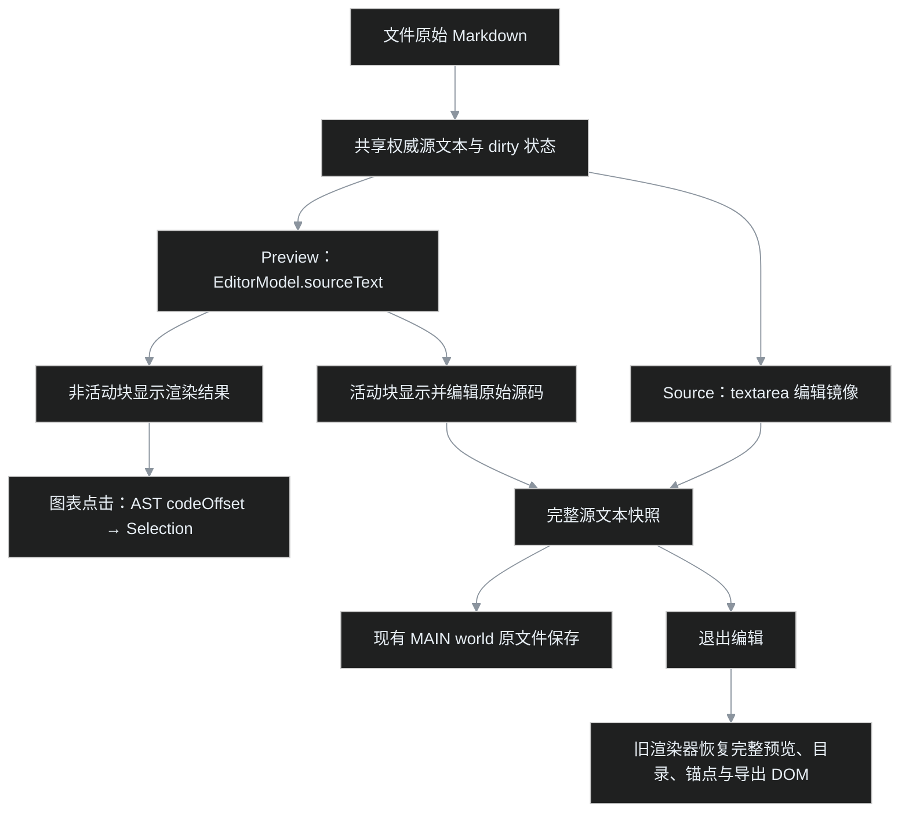
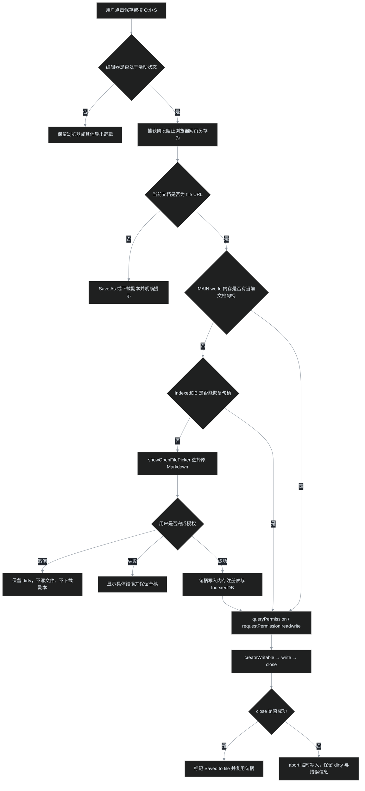

# 浏览器编辑 Markdown 与原文件保存

> 调研与实现约束，2026-11-13。适用于本 fork 的 Chrome / Edge 混合编辑器与源码编辑器；Firefox、移动端和在线文档不承诺相同能力。

## 结论

浏览器可以编辑 Markdown 并覆盖本地原文件，但不能仅凭 `file:///...` 地址静默写入。正确方式是：**用户交互 → 明确选择文件 → 取得文件句柄与写权限 → 写入并关闭流**。首次授权后，句柄同时保存在 MAIN world 内存注册表和 IndexedDB；后续 Ctrl+S 及页面重载都应复用或恢复句柄、重新核验写权限，而不是再次弹文件选择器，也不应退化为下载副本。

如果编辑态 Ctrl+S 仍出现浏览器“网页另存为”，说明快捷键没有进入编辑器保存逻辑；如果出现 `showSaveFilePicker()` 或下载，则说明走到了“保存副本”分支。这两种情况都不能记作原文件写回成功。

## 能力边界

| 场景 | 可实现的保存结果 | 必要条件或限制 |
|---|---|---|
| 普通网页直接按 Ctrl+S | 浏览器默认“网页另存为” | 页面须拦截快捷键并调用自己的保存逻辑 |
| `<input type="file">` 读取的 `File` | 下载编辑后的副本 | 普通 `File` 不提供原文件写回能力 |
| `showOpenFilePicker()` 取得的文件句柄 | 覆盖用户选中的原文件 | 安全上下文、transient user activation、文件句柄和写权限 |
| 只有 `file://` URL，没有文件句柄 | 不能据此直接覆盖磁盘文件 | “允许访问文件 URL”只解决扩展读取/注入权限，不是任意写文件权限 |
| 在线 Markdown | 另存副本；站点另有 API 时才可提交远端 | 扩展不应把远端文档当本地原文件写入 |
| 不支持 File System Access API 的浏览器 | 下载副本或交由原生助手保存 | 不伪装成原文件写回 |

`showOpenFilePicker()` 在 MDN 中仍标为 **Limited availability**，因此运行时必须做能力检测，不能只凭 Chromium 内核名称假定所有上下文均可用。

## 混合编辑架构

编辑入口默认是单栏 **Preview**：非活动块显示渲染结果，点击块后直接编辑该块的 Markdown 源码；**Source** 保留原 textarea 与旧分栏预览，作为特殊语法和兼容性兜底。两个视图共享保存状态、Ctrl/Cmd+S、dirty、外部修改冲突条和同一份权威源文本，不是两个独立文档。

实现复用 **`@vscode/markdown-editor@0.0.2-179`** 的 `EditorModel`、`EditorView`、`EditorController` 和 `LocalHistoryStrategy`。`EditorModel.sourceText` 保存精确 Markdown，不做任意 HTML → Markdown 往返；保存直接读取完整模型快照。权威外部内容通过 `replaceSourceText()` 载入，并抑制初始化及回显过程中的 `onInput`，防止空内容覆盖草稿。

### 渲染与源码边界

- **Preview 输入不重绘旧阅读 DOM。** 每次输入只更新源文本和 dirty；Source 输入才继续排队更新旧分栏预览。退出编辑时，按 `sourceEditorPreviewContent` 判断是否需要用最新源文本恢复完整阅读 DOM。
- **textarea 不是换行的权威存储。** DOM 的 `textarea.value` 会把 CRLF 规范化为 LF，因此 `sourceContent` 独立保存精确文本。仅切换 Preview/Source 不改源文本；在 Source 中实际编辑后，沿用首次载入时检测出的 CRLF/LF 风格。混合文件的原始字节在未编辑时保留，实际 Source 编辑不承诺逐行保留混合换行。
- **图表继续走原安全渲染服务。** Mermaid 等非活动 fence 复用 `platform.renderer.render()` 和 `createPluginResultElement()`。组件对自定义块缺少可靠命中映射，因此占位根节点的 `pointerdown` 通过 AST 累计偏移和 `CodeBlockAstNode.codeOffset` 设置 `Selection.collapsed()`；收集时排除已展开的活动图表，保证连续点击多个图表不会错位。渲染失败保留原始 fence 可编辑。
- **同源文本，不等于同渲染管线。** Preview 使用 VS Code 组件内建的 Markdown 块渲染；完整阅读态继续使用原 markdown-it、目录、锚点、图表和导出管线。Slidev、HTML 转 Markdown、workspace/嵌入模式不开放本地源码编辑入口。
- **运行要求是支持 `EditContext` 的现代 Chromium。** 当前构建目标为 Chrome 120；旧浏览器或不完整实现应使用 Source 兜底，不应把混合编辑器退化为简单 `contenteditable`。

### 阅读位置与布局连续性

阅读和 Preview 是两个不同排版、不同滚动容器，不能互相复制像素 `scrollTop`。切换时沿用 VS Code 的源码导航通路：阅读块 `data-line` → 0-based source line → 精确 Markdown 字符 offset → `Selection` / `OffsetRange` → `revealRangeAtTop()`。换行扫描同时支持 CRLF、LF 和 CR；CRLF 的字符 offset 必须计入两个字符。

| 阅读布局 | Preview 内容宽度 | 同步方式 |
|---|---:|---|
| normal | 最大 `1360px` | 向 `limitedWidth` observable 写入数值 `1360` |
| fullscreen | 不限宽，随视口变化 | observable 的**值**设为 `undefined` |
| narrow | 最大 `680px` | 向 `limitedWidth` observable 写入数值 `680` |

进入编辑和工具栏布局切换都更新同一个 observable。不能省略 `limitedWidth`（组件默认会变成 `900px`），也不能用普通选项 `limitedWidth: undefined` 代替可写 observable；normal、fullscreen、narrow 不互相拉平。

定位与退出遵循以下规则：

- 激活后在有界的 animation frame 窗口内重复 reveal，覆盖首次测量及图片、Mermaid 等异步高度变化；新定位、权威内容替换、停用以及 wheel、pointer、touch、key 输入都会取消旧任务，避免延迟校正抢回用户已经滚走的位置。
- 退出前从公开 `documentViewNode.blocks` 中捕获视口内首个正文块，排除 `emptyBlock`，再由 `absoluteStart` 转回 source line，并显式交给阅读预览的渲染与恢复管线。
- 阅读行号可能带有块内小数进度。若本次进入后没有真实滚动或编辑，退出直接保留进入时的精确行号，避免反复取整到块起点而累计漂移；实际编辑可能在其上方增删行，因此编辑后重新捕获，不能沿用旧行号。
- 连续切换、文档重置或新渲染会使旧的预览恢复任务失效。恢复只保证对应源码块和块内位置，不宣称两种渲染器具有相同像素几何。

## 保存架构

### 为什么使用页面 MAIN world

扩展 isolated world 与页面 MAIN world 都能看见部分 Web API，不代表权限行为相同。WICG 的扩展相关 issue 记录了文件选择器、句柄权限提示的 Chromium 实现问题。因此本 fork 让页面 MAIN world 持有 `FileSystemFileHandle`，isolated world 只通过 DOM `CustomEvent` 传递文本请求与状态。

活文件句柄不跨 world 传递；句柄按去掉锚点后的文档 URL 隔离，避免页内打开另一份 Markdown 后误写旧文件。内存注册表保留在首次注入的闭包中，`ready` 标记防止重复注入时重置；IndexedDB 负责页面重载后的恢复。句柄不挂到 `window`，避免把写权限暴露给其他页面脚本。持久化失败不阻断本次保存，当前页仍走内存复用。

本机 Edge 实测确认 `file://` 页面可使用并在重载后保留 IndexedDB，但不能使用 OPFS（`navigator.storage.getDirectory()` 抛 `SecurityError`）。因此持久化自动化在扩展源页面取得真实、可序列化的 OPFS `FileSystemFileHandle`；本地文件页的 picker 仍使用 mock。这个架构是规避已知扩展上下文问题的实现选择，**不是对真实 Edge 原生对话框和磁盘写入的自动化测试替代品**。

## 实现不变量

1. **原文件保存与副本保存必须可区分。** 本地 `file://` 使用 `showOpenFilePicker()`；在线文档才使用 `showSaveFilePicker()` 或下载。
2. **本地失败不静默下载。** 授权失败、API 不可用或写入异常时保留 dirty，并显示真实错误；不得让“下载成功”掩盖原文件未写入。
3. **快捷键在编辑态优先处理。** 编辑器创建后立即绑定捕获阶段 Ctrl/Cmd+S，阻止 Edge 默认 Save Page 和后续工具栏监听器重复处理。
4. **保存以完整源码为真源。** 保留末尾换行，不从渲染 DOM 或 textarea 的换行规范化结果反推 Markdown。
5. **句柄与文档一一对应。** 中文路径和 `#` 锚点不得改变本地文档判断；文档切换后不得复用旧句柄。
6. **失败写入不能提交半份文件。** `createWritable()` 后执行 `write()`，仅在成功时 `close()`；异常时 `abort()`。
7. **保存期间继续输入仍保持未保存。** 只更新本次快照的保存基线，不能把较新的输入一并标为已保存。
8. **外部磁盘修改不得静默覆盖草稿。** 冲突由用户明确选择加载磁盘版本或保留草稿。
9. **句柄复用不能被重载或重复注入重置。** 优先读取 MAIN world 内存，再恢复 IndexedDB，最后才显示 picker；恢复后仍须重新核验 `readwrite` 权限。
10. **Preview 与 Source 不得产生两份草稿。** 模式切换、任务框、图表 fence 编辑和撤销/重做都更新同一权威源文本。
11. **混合输入不能销毁自身。** 旧阅读渲染器不得在 Preview 每次按键时替换编辑 DOM；退出编辑才恢复最新完整预览。

## 验收矩阵

| 层级 | 能验证什么 | 不能替代什么 |
|---|---|---|
| 保存模块契约测试 | picker 分支、句柄复用、精确文本、取消、异常 abort、本地失败不下载 | 真实系统对话框与真实磁盘 |
| 安装扩展混合编辑 E2E | 渲染标题真实键盘输入、undo/redo、任务框、双 Mermaid 点击、CRLF、Preview/Source 往返、冲突保护、退出恢复 | 中文 IME、所有图表类型与所有主题的人工视觉验收 |
| 安装扩展保存 E2E（Playwright Chromium / 本机 Edge） | 中文路径＋编码锚点、真实 Ctrl+S 事件、MAIN world 桥、dirty、保存期间继续输入、真实 OPFS 句柄在重复注入与重载后恢复 | 本地文件原生授权 UI 与真实磁盘覆盖 |
| 真实 Edge 人工验收 | 原生“打开”授权、连续保存与重载后免选择器、磁盘文件确实更新、Edge 默认另存为被拦截 | — |
| Edge ZIP 完整性检查 | 构建入口、文件清单、压缩包 CRC | 编辑器行为正确性 |

真实 Edge 验收使用临时 Markdown 副本，不使用用户原始调研文件做写入测试：

- [ ] 在长文档中部进入 Preview，对应标题或段落仍可见；未修改及修改后退出均回到对应阅读块，连续切换不累计漂移。
- [ ] normal、fullscreen、narrow 三档进入 Preview 后分别保持 `1360px`、不限宽、`680px`，编辑中切换布局也保持相同语义。
- [ ] CRLF 文档及目标上方延迟加载图片不会把定位挤到相邻段；主动滚动后不被旧校正拉回。
- [ ] Preview 中点击标题、段落和列表，真实输入、撤销/重做及中文 IME 正常；Source 往返不丢文本。
- [ ] Mermaid、PlantUML 非活动块正常显示，点击后编辑对应原始 fence；至少连续点击两个图表确认映射。
- [ ] 切换明暗主题并检查窄屏布局；图表、正文、活动源码和状态栏保持可读。
- [ ] 退出编辑后恢复完整预览、目录、锚点与导出 DOM；未保存关闭或导航仍触发离开保护。
- [ ] 编辑临时副本后按 Ctrl+S，不出现浏览器“网页另存为”。
- [ ] 第一次本地保存只要求通过“打开”对话框选择当前文件；后续保存复用句柄。
- [ ] 保存后重载同一 Markdown，再按 Ctrl+S，只核验权限，不要求重新从文件夹选择文件。
- [ ] 保存后磁盘内容逐字等于编辑器内容，状态为 `Saved to file`，dirty 清除。
- [ ] 取消选择器后仍显示未保存，不产生下载副本。
- [ ] 拒绝权限或写入失败时显示具体错误，原文件不被截断。
- [ ] 保存期间继续输入，较早快照保存后，较新内容仍保持 dirty。
- [ ] 在线 Markdown 明确显示“保存副本”，不冒充本地写回。

## 证据与来源

以下来源在本轮通过 `gh` / `curl` 实际读取。Chromium issue 页面连接超时，因此相关缺陷仅引用 WICG issue 中维护者的说明，不另行声称已读取 Chromium 原页。

| 来源 | 支持的结论 |
|---|---|
| [MDN：Window.showOpenFilePicker()](https://developer.mozilla.org/en-US/docs/Web/API/Window/showOpenFilePicker) | 安全上下文、用户激活、文件句柄、取消与 SecurityError |
| [MDN：FileSystemFileHandle.createWritable()](https://developer.mozilla.org/en-US/docs/Web/API/FileSystemFileHandle/createWritable) | readwrite 权限；通常先写临时文件，close 后替换目标 |
| [VS Code：浏览器文件选择与句柄注册](https://github.com/microsoft/vscode/blob/main/src/vs/workbench/services/dialogs/browser/fileDialogService.ts) | 网页版使用 showOpenFilePicker / showSaveFilePicker 区分打开与另存 |
| [VS Code：浏览器文件系统写入](https://github.com/microsoft/vscode/blob/main/src/vs/platform/files/browser/htmlFileSystemProvider.ts) | 文件句柄注册、IndexedDB 持久化、createWritable → write → close |
| [VS Code：Markdown 编辑器接入层](https://github.com/microsoft/vscode/blob/c1263db0c58cde7cd15e9be2e53b255acd3f1629/extensions/markdown-language-features/src/preview/markdownEditorProvider.ts) | TextDocument 唯一真源、权威文本替换与保存职责 |
| [VS Code：混合编辑器浏览器前端](https://github.com/microsoft/vscode/blob/c1263db0c58cde7cd15e9be2e53b255acd3f1629/extensions/markdown-language-features/markdown-editor-src/editor.ts) | EditorModel、EditorView、EditorController 与历史策略组合 |
| [@vscode/markdown-editor 0.0.2-179](https://www.npmjs.com/package/@vscode/markdown-editor/v/0.0.2-179) | 非活动块渲染、活动块编辑精确 Markdown；独立浏览器宿主公开 API |
| [VS Code：Markdown 编辑器构建配置](https://github.com/microsoft/vscode/blob/c1263db0c58cde7cd15e9be2e53b255acd3f1629/extensions/markdown-language-features/esbuild.markdownEditor.mts) | 浏览器 external 与字体打包方式 |
| [VS Code：预览与编辑器导航](https://github.com/microsoft/vscode/blob/c1263db0c58cde7cd15e9be2e53b255acd3f1629/extensions/markdown-language-features/src/preview/markdownEditorNavigation.ts) | source line 与编辑器位置互通；公开 Selection / OffsetRange / reveal 导航，不跨排版复制 scrollTop |
| [MIT 许可文本](https://github.com/microsoft/vscode/blob/main/LICENSE.txt) | 本 fork 随构建附带的 VS Code Markdown 编辑器许可依据；组件 package.json 声明 MIT |
| [WICG/file-system-access #289](https://github.com/WICG/file-system-access/issues/289) | 扩展句柄权限提示问题；维护者归类为 Chromium 实现问题 |
| [WICG/file-system-access #314](https://github.com/WICG/file-system-access/issues/314) | 扩展目录选择器失败；规范仓库不作为规范问题处理 |
| [WICG/file-system-access #297](https://github.com/WICG/file-system-access/issues/297) | 权限持久化演进；Chromium 122 起改善跨会话权限体验 |
| [Markydowny #8](https://github.com/workingdevshero/markydowny/issues/8) | 另一 Markdown 编辑器采用相同的有句柄写回、无句柄下载设计 |

## 当前排障边界

本地文件页的自动化 picker 仍是 mock；真实 OPFS 句柄只验证序列化与恢复机制，不能据此宣称原生 Edge 本地文件写回已经验收。真实 Edge 中若仍反复出现文件选择器，必须分别确认：

1. Ctrl+S 是否到达编辑器捕获监听器；
2. 当前保存目标是 `file://` 还是在线 URL；
3. 实际调用的是 `showOpenFilePicker`、`showSaveFilePicker`，还是浏览器 Save Page；
4. picker 是否抛出 `AbortError`、`SecurityError` 或其他异常；
5. `write()` 与 `close()` 是否都成功完成。

只有磁盘副本内容更新且 dirty 正确清除，才能结束“原文件保存”验收。
