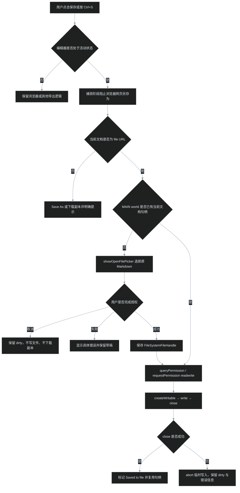

# 浏览器编辑 Markdown 与原文件保存

> 调研与实现约束，2026-11-12。适用于本 fork 的 Chrome / Edge 源码编辑器；Firefox、移动端和在线文档不承诺相同能力。

## 结论

浏览器可以编辑 Markdown 并覆盖本地原文件，但不能仅凭 `file:///...` 地址静默写入。正确方式是：**用户交互 → 明确选择文件 → 取得文件句柄与写权限 → 写入并关闭流**。首次授权后，同一页面生命周期内复用句柄，后续 Ctrl+S 不应再次弹选择器，也不应退化为下载副本。

如果编辑态 Ctrl+S 仍出现浏览器“网页另存为”，说明快捷键没有进入编辑器保存逻辑；如果出现 `showSaveFilePicker()` 或下载，则说明走到了“保存副本”分支。这两种情况都不能记作原文件写回成功。

## 能力边界

| 场景 | 可实现的保存结果 | 必要条件或限制 |
|---|---|---|
| 普通网页直接按 Ctrl+S | 浏览器默认“网页另存为” | 页面须拦截快捷键并调用自己的保存逻辑 |
| `<input type="file">` 读取的 `File` | 下载编辑后的副本 | 普通 `File` 不提供原文件写回能力 |
| `showOpenFilePicker()` 取得的文件句柄 | 覆盖用户选中的原文件 | 安全上下文、transient user activation、文件句柄和写权限 |
| 只有 `file://` URL，没有文件句柄 | 不能据此直接覆盖磁盘文件 | “允许访问文件 URL”只解决扩展读取/注入权限，不是任意写文件权限 |
| 在线 Markdown | 另存副本；站点另有 API 时才可提交远端 | 扩展不应把远端文档当本地原文件写入 |
| 不支持 File System Access API 的浏览器 | 下载副本或交由原生助手保存 | 不伪装成原文件写回 |

`showOpenFilePicker()` 在 MDN 中仍标为 **Limited availability**，因此运行时必须做能力检测，不能只凭 Chromium 内核名称假定所有上下文均可用。

## 保存架构

### 为什么使用页面 MAIN world

扩展 isolated world 与页面 MAIN world 都能看见部分 Web API，不代表权限行为相同。WICG 的扩展相关 issue 记录了文件选择器、句柄权限提示的 Chromium 实现问题。因此本 fork 让页面 MAIN world 持有 `FileSystemFileHandle`，isolated world 只通过 DOM `CustomEvent` 传递文本请求与状态。

活文件句柄不跨 world 传递；句柄按去掉锚点后的文档 URL 隔离，避免页内打开另一份 Markdown 后误写旧文件。这个架构是规避已知扩展上下文问题的实现选择，**不是对真实 Edge 原生对话框和磁盘写入的自动化测试替代品**。

## 实现不变量

1. **原文件保存与副本保存必须可区分。** 本地 `file://` 使用 `showOpenFilePicker()`；在线文档才使用 `showSaveFilePicker()` 或下载。
2. **本地失败不静默下载。** 授权失败、API 不可用或写入异常时保留 dirty，并显示真实错误；不得让“下载成功”掩盖原文件未写入。
3. **快捷键在编辑态优先处理。** 编辑器创建后立即绑定捕获阶段 Ctrl/Cmd+S，阻止 Edge 默认 Save Page 和后续工具栏监听器重复处理。
4. **保存以完整源码为真源。** 保留末尾换行，不从渲染 DOM 反推 Markdown。
5. **句柄与文档一一对应。** 中文路径和 `#` 锚点不得改变本地文档判断；文档切换后不得复用旧句柄。
6. **失败写入不能提交半份文件。** `createWritable()` 后执行 `write()`，仅在成功时 `close()`；异常时 `abort()`。
7. **保存期间继续输入仍保持未保存。** 只更新本次快照的保存基线，不能把较新的输入一并标为已保存。
8. **外部磁盘修改不得静默覆盖草稿。** 冲突由用户明确选择加载磁盘版本或保留草稿。

## 验收矩阵

| 层级 | 能验证什么 | 不能替代什么 |
|---|---|---|
| 保存模块契约测试 | picker 分支、句柄复用、精确文本、取消、异常 abort、本地失败不下载 | 真实系统对话框与真实磁盘 |
| 安装扩展 E2E（Playwright Chromium） | 中文路径＋编码锚点、真实 Ctrl+S 事件、MAIN world 桥、dirty、保存期间继续输入 | Edge 品牌差异与原生授权 UI |
| 真实 Edge 人工验收 | 原生“打开”授权、后续免选择器保存、磁盘文件确实更新、Edge 默认另存为被拦截 | — |
| Edge ZIP 完整性检查 | 构建入口、文件清单、压缩包 CRC | 编辑器行为正确性 |

真实 Edge 验收使用临时 Markdown 副本，不使用用户原始调研文件做写入测试：

- [ ] 编辑临时副本后按 Ctrl+S，不出现浏览器“网页另存为”。
- [ ] 第一次本地保存只要求通过“打开”对话框选择当前文件；后续保存复用句柄。
- [ ] 保存后磁盘内容逐字等于编辑器内容，状态为 `Saved to file`，dirty 清除。
- [ ] 取消选择器后仍显示未保存，不产生下载副本。
- [ ] 拒绝权限或写入失败时显示具体错误，原文件不被截断。
- [ ] 保存期间继续输入，较早快照保存后，较新内容仍保持 dirty。
- [ ] 在线 Markdown 明确显示“保存副本”，不冒充本地写回。

## 证据与来源

以下来源在本轮通过 `gh` / `curl` 实际读取。Chromium issue 页面连接超时，因此相关缺陷仅引用 WICG issue 中维护者的说明，不另行声称已读取 Chromium 原页。

| 来源 | 支持的结论 |
|---|---|
| [MDN：Window.showOpenFilePicker()](https://developer.mozilla.org/en-US/docs/Web/API/Window/showOpenFilePicker) | 安全上下文、用户激活、文件句柄、取消与 SecurityError |
| [MDN：FileSystemFileHandle.createWritable()](https://developer.mozilla.org/en-US/docs/Web/API/FileSystemFileHandle/createWritable) | readwrite 权限；通常先写临时文件，close 后替换目标 |
| [VS Code：浏览器文件选择与句柄注册](https://github.com/microsoft/vscode/blob/main/src/vs/workbench/services/dialogs/browser/fileDialogService.ts) | 网页版使用 showOpenFilePicker / showSaveFilePicker 区分打开与另存 |
| [VS Code：浏览器文件系统写入](https://github.com/microsoft/vscode/blob/main/src/vs/platform/files/browser/htmlFileSystemProvider.ts) | 文件句柄注册、IndexedDB 持久化、createWritable → write → close |
| [WICG/file-system-access #289](https://github.com/WICG/file-system-access/issues/289) | 扩展句柄权限提示问题；维护者归类为 Chromium 实现问题 |
| [WICG/file-system-access #314](https://github.com/WICG/file-system-access/issues/314) | 扩展目录选择器失败；规范仓库不作为规范问题处理 |
| [WICG/file-system-access #297](https://github.com/WICG/file-system-access/issues/297) | 权限持久化演进；Chromium 122 起改善跨会话权限体验 |
| [Markydowny #8](https://github.com/workingdevshero/markydowny/issues/8) | 另一 Markdown 编辑器采用相同的有句柄写回、无句柄下载设计 |

## 当前排障边界

自动化中的文件句柄是 mock，不能据此宣称原生 Edge 写回已经验收。真实 Edge 中若仍出现“另存为”，必须分别确认：

1. Ctrl+S 是否到达编辑器捕获监听器；
2. 当前保存目标是 `file://` 还是在线 URL；
3. 实际调用的是 `showOpenFilePicker`、`showSaveFilePicker`，还是浏览器 Save Page；
4. picker 是否抛出 `AbortError`、`SecurityError` 或其他异常；
5. `write()` 与 `close()` 是否都成功完成。

只有磁盘副本内容更新且 dirty 正确清除，才能结束“原文件保存”验收。
